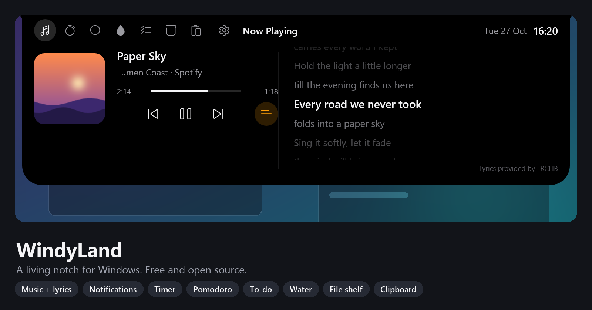
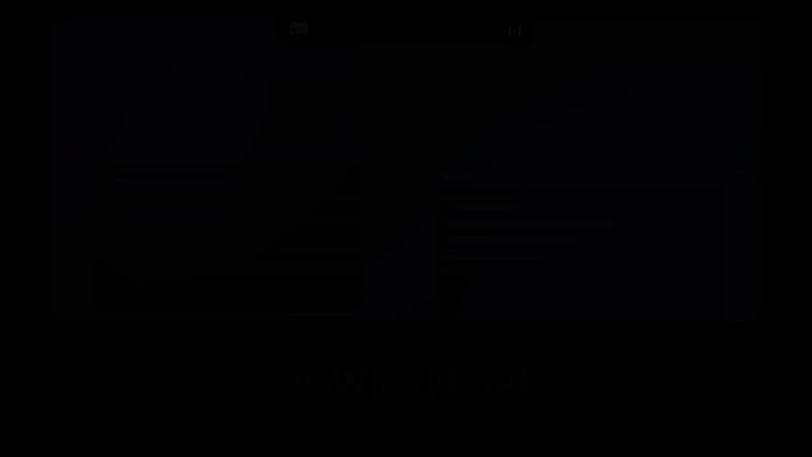
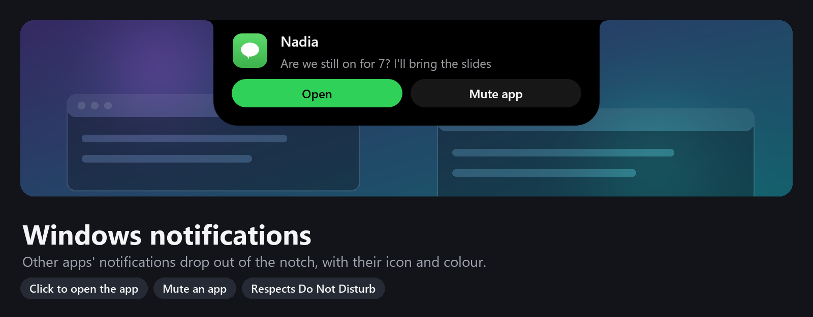
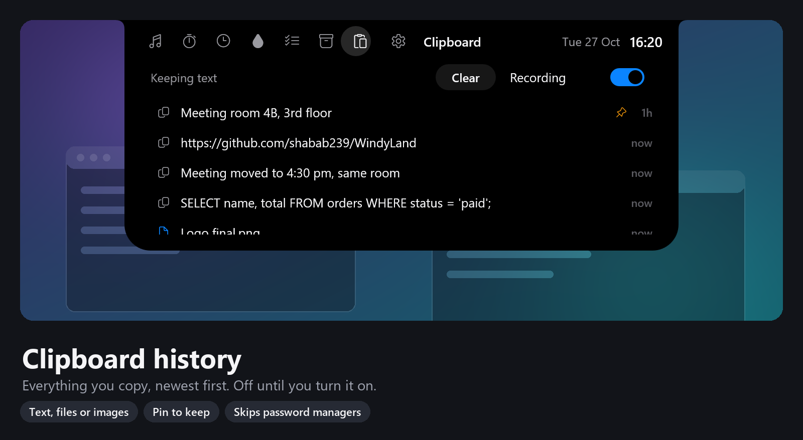
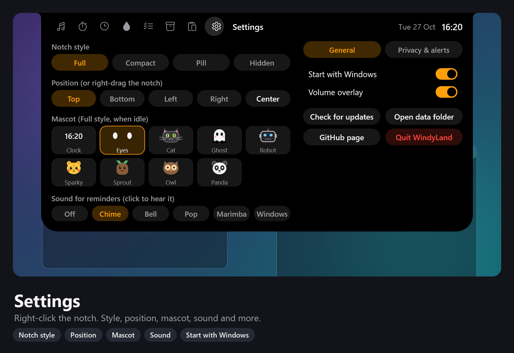

<p align="center"></p>

# WindyLand

A living notch for Windows 10 and 11, like the Dynamic Island. Music with
synced lyrics, your Windows notifications, a timer, Pomodoro, to-do
reminders, a water reminder, a file shelf, clipboard history and mic and
camera in-use dots, all in a small pill at the edge of your screen. Hover to
open, move away to close. Free and open source.

<p align="center"></p>

## Features

| | |
|---|---|
|  |  |
| **Now playing + synced lyrics** from any media app | **Windows notifications** in the notch, with the app's icon |
|  |  |
| **Timer and stopwatch** with presets, alerts and laps | **Pomodoro** focus sessions |
|  |  |
| **To-do** with timed reminders | **Water reminder** with an hourly chart |
|  |  |
| **File shelf**: drop in, drag out | **Clipboard history**: text, files or images, pin to keep |


Battery, network, Caps Lock, keyboard language, volume and Bluetooth alerts are
built in, and a dot shows while any app uses your microphone or camera.



| | |
|---|---|
|  |  |
| **Mascots** that follow your mouse when nothing's on | **Any edge** of any screen |

Your data stays on your PC. The only network requests are to
[LRCLIB](https://lrclib.net) for lyrics and to GitHub to check for updates.
Notifications, clipboard history and the mic and camera dots are read
locally, and notifications and clipboard history are off until you turn them
on.

## Install

Download `WindyLandSetup-<version>.exe` from
[Releases](https://github.com/shabab239/WindyLand/releases) and run it. It
installs per user, no admin rights needed. A short welcome tour lets you pick
the look, and later versions install with one click from the notch.

**Quick start:** hover the notch to open it, right-click it for settings,
right-click and drag to move it. See the **[User guide](docs/USER_GUIDE.md)**.

## Build

Needs Rust (stable, GNU or MSVC toolchain).

```powershell
cargo build --release                       # target\release\windyland.exe
.\target\release\windyland.exe --selftest   # headless checks
.\build.ps1                                 # build + icon + self-test + installer (Inno Setup 6)
python docs\tools\make_images.py            # regenerate the screenshots and demo (Pillow, numpy, ffmpeg)
```

## Adding a feature

Each feature is one file in `src/modules/` implementing the `Module` trait.
Copy `src/modules/example.rs` and register it in `modules::all()`.
Mascots live in `src/mascot.rs`: add a variant to `store::Mascot` and a draw
function.

## License

[MIT](LICENSE)
