# WindyLand user guide

- [Getting started](#getting-started)
- [Open and close](#open-and-close)
- [Move it to any edge](#move-it-to-any-edge)
- [Notch styles](#notch-styles)
- [Now playing and lyrics](#now-playing-and-lyrics)
- [Timer and stopwatch](#timer-and-stopwatch)
- [Pomodoro](#pomodoro)
- [To-do with reminders](#to-do-with-reminders)
- [Water reminder](#water-reminder)
- [Prayer times](#prayer-times)
- [Tools](#tools)
- [AI agents](#ai-agents)
- [System monitor](#system-monitor)
- [Widgets: what the closed notch shows](#widgets-what-the-closed-notch-shows)
- [Calendar](#calendar)
- [Themes and seconds](#themes-and-seconds)
- [Uninstalling](#uninstalling)
- [File shelf](#file-shelf)
- [Clipboard history](#clipboard-history)
- [Mic and camera dots](#mic-and-camera-dots)
- [Windows notifications in the notch](#windows-notifications-in-the-notch)
- [Alerts and overlays](#alerts-and-overlays)
- [The mascot](#the-mascot)
- [Settings and your data](#settings-and-your-data)
- [Updates](#updates)
- [Troubleshooting](#troubleshooting)

## Getting started

1. Run `WindyLandSetup-<version>.exe`. Tick **Start WindyLand when Windows starts** if you like.
2. The notch opens with a short **welcome tour**: pick how it looks when closed (Full, Compact, Pill or Hidden), pick the screen edge, read three quick tips (hover to open, the mouse wheel switches panels, right-drag to move it), and see what's in Settings at a glance. **Open Settings** on the last step goes straight there. You can skip it, and replay it later from the tray icon's menu (**Welcome tour**). Everything you pick can be changed later in Settings.

   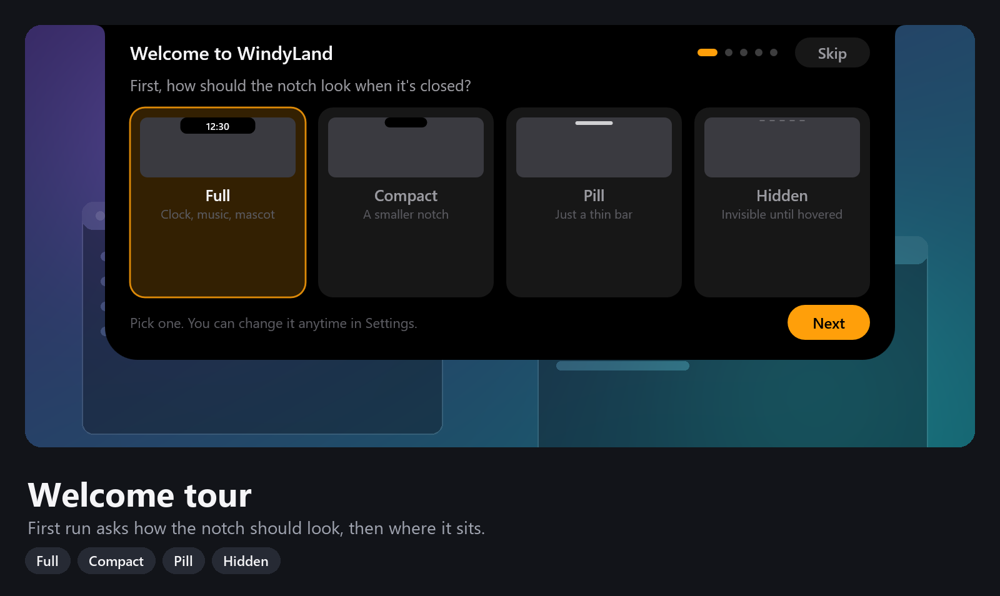

3. A tray icon (a pill with two eyes) appears near the clock.
4. To quit, right-click the tray icon and choose **Exit**, or use **Quit WindyLand** in Settings.

## Open and close

- **Hover** the notch to open it. Move the mouse away and it closes.
- **Click** the notch to open it straight away.
- The icons along the top of the open panel switch between features. The **mouse wheel** does too: roll down for the next panel, up for the previous one. On a list that scrolls (to-do, clipboard, lyrics) the wheel scrolls the list; over the icons it always switches.
- It always opens on the panel you last picked, even after a restart. (A reminder can open another panel for a moment; next time it's back to yours.)
- Don't use a panel? Hide it in **Settings > Panels**.
- The smaller styles (Compact, Pill, Hidden) wait a moment before opening, so reaching for browser tabs does not open them by accident.

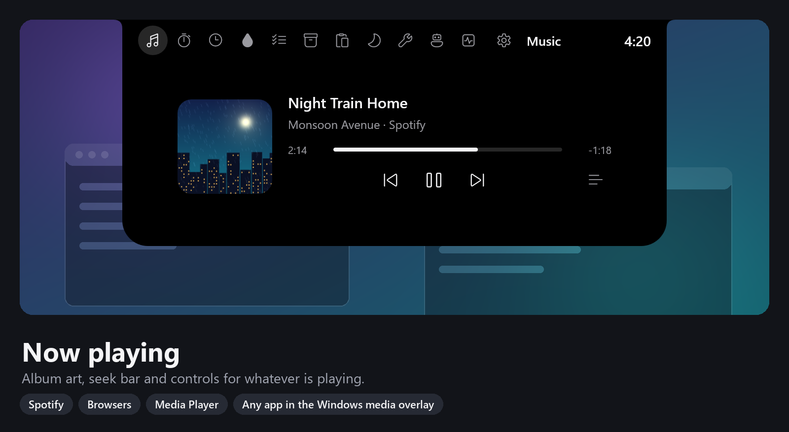

## Move it to any edge

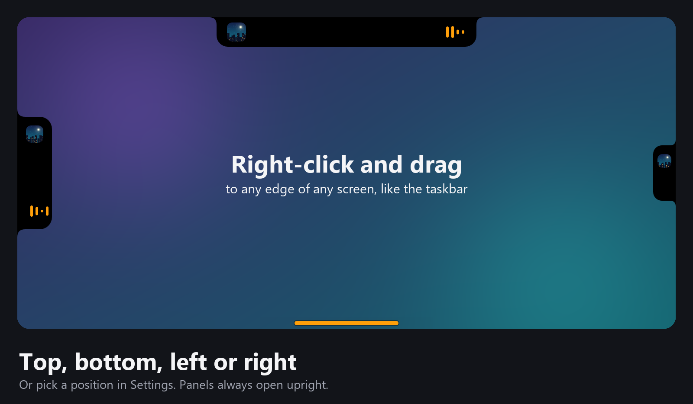

- **Right-click and drag** the notch. It snaps to the nearest edge of whichever screen the mouse is on: top, bottom, left or right. Let go to place it.
- Or open **Settings** and pick an edge under **Position**. **Center** puts it back in the middle.
- On the left and right edges the closed notch becomes a vertical tab. Panels always open upright.
- A plain right-click (without dragging) opens Settings.

## Notch styles

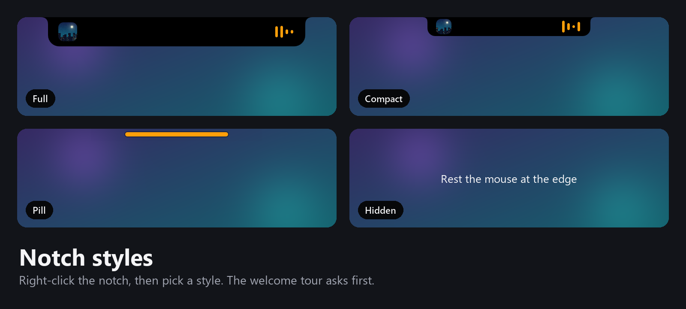

Open **Settings** and pick one under **Notch style**:

| Style | Looks like | Best for |
|---|---|---|
| Full | Black notch with the clock, music and timers | Seeing everything at a glance |
| Slim | Full, but narrower (120 at rest, 200 while music or a timer runs), and the open panel is a little smaller | Full's look in less space |
| Compact | A smaller notch | Less space, still glanceable |
| Pill | A thin bar, tinted while music or a timer runs | Almost invisible |
| Hidden | Nothing | Rest the mouse at the edge to open |

**Windows under the notch (smart hide):** when a window's top (title bar, tabs, address bar) is under the notch, for example a maximized browser or one dragged to the top, the notch steps aside to a thin line and clicks go straight through to the window. After about 2.5 seconds it comes back, still click-through. When your mouse comes near it (to reach the tabs or address bar), it steps aside again and comes back 2 seconds after the mouse leaves. Rest the mouse on the notch itself to open it. Switching to a window under it, or dragging a window across the top, makes it step aside too. Alerts still drop down as usual. Turn this off with **Step aside for windows under it** in Settings > General.

## Now playing and lyrics

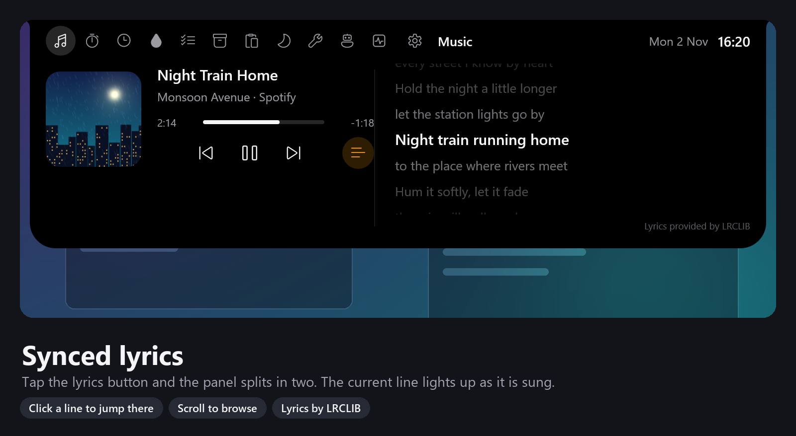

- Works with anything that shows in the Windows media overlay: Spotify, YouTube and other sites in Chrome, Edge or Firefox, Media Player and more.
- **Click the progress bar** to seek. Use the previous, play/pause and next buttons.
- If a player turns down a skip (some web players), WindyLand presses the media key for you instead. The previous and next buttons look dimmed when the player says it can't skip right now (a single video, the first track). Most players restart the song when you press previous a few seconds in; press it twice to go back a track.
- **Lyrics**: click the lines button on the right. The panel splits and the current line lights up. Click a line to jump to it, or scroll to look ahead.
- When music plays, the closed notch shows the album art on the left, a small equaliser on the right and the clock in the middle (on the top and bottom edges, unless a centred mascot sits there). Timers, Pomodoro, prayer times, due tasks, AI agents and the system monitor keep the clock in the middle the same way.
- Some songs have no lyrics on LRCLIB yet; the panel then says *Lyrics not available*.

## Timer and stopwatch

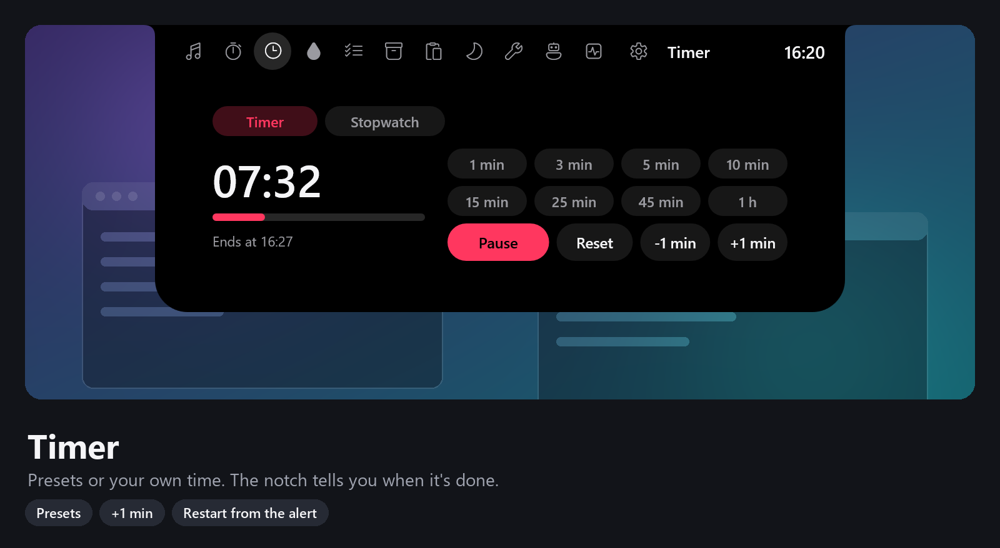

**Countdown**

1. Open the **Timer** tab (the clock icon).
2. Pick a preset (1 min to 1 h) or use **-1 min** / **+1 min**. While it is stopped you can also scroll over the panel to change it by a minute.
3. Press **Start**. The time left and *Ends at* show in the panel, and a countdown ring stays in the closed notch.
4. **+1 min / -1 min** also work while it is running, without restarting.
5. When it finishes it chimes and drops an alert with **Restart** and **Dismiss**.

WindyLand remembers your last duration.

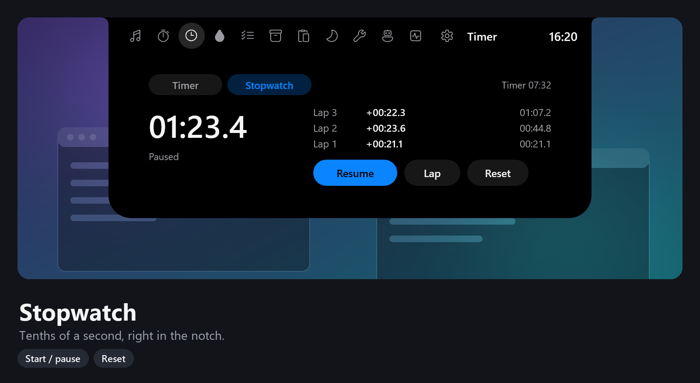

**Stopwatch**: switch to **Stopwatch**, then **Start**, **Lap** and **Reset**. Laps show the split and the total.

## Pomodoro

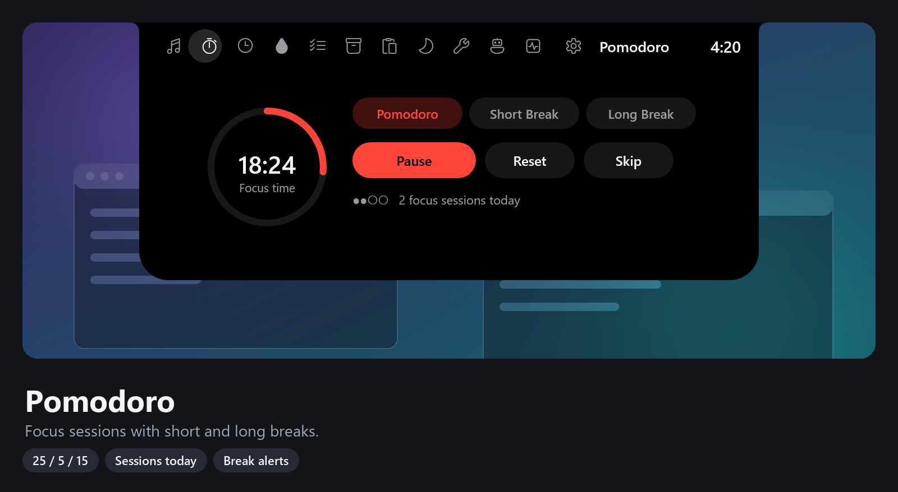

- 25 minutes of focus, then a 5 minute break. Every fourth break is 15 minutes.
- **Start / Pause**, **Reset** and **Skip** control the current phase.
- At the end of each phase it chimes and offers **Start** for the next one, or **Later**.
- The dots show your progress through the cycle of four.

## To-do with reminders

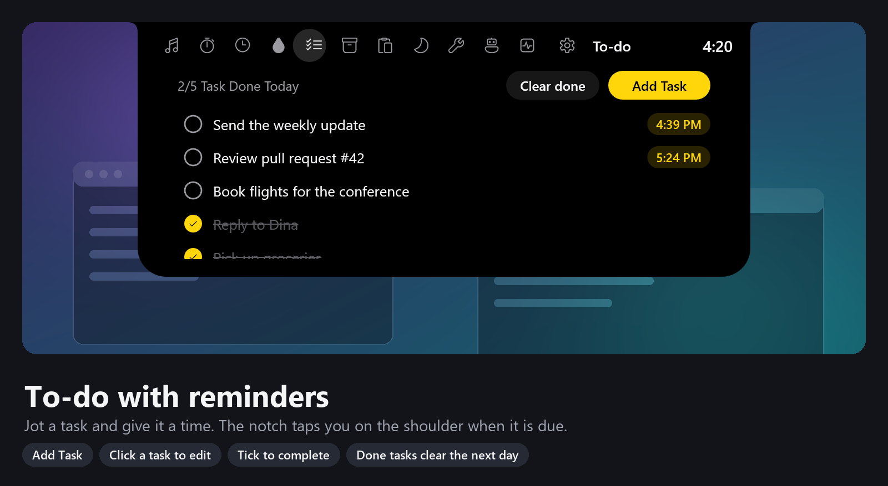

- **Add Task**, type a title, and optionally give it a time.
- Click a task to edit it. Click the circle to tick it off. Hover a task to delete it.
- When a task is due, the notch drops down with **Done** and **Snooze 10m**.
- Tasks you complete are cleared the next day. **Clear done** removes them now.

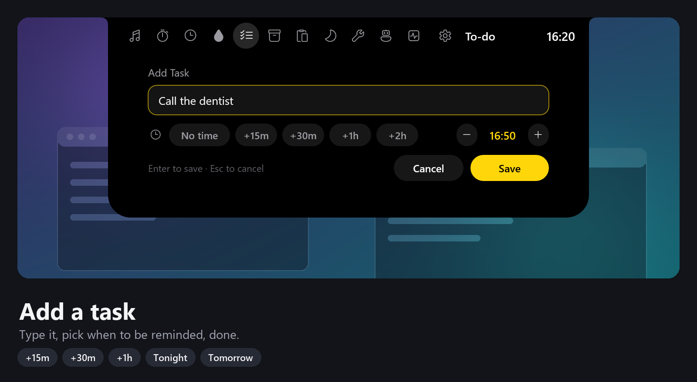

**Setting a time:** tap **+15m**, **+30m**, **+1h** or **+2h** (they add up), then fine-tune with **-** and **+**. **No time** means no reminder. Press **Enter** to save or **Esc** to cancel. You can paste with **Ctrl+V**.

## Water reminder

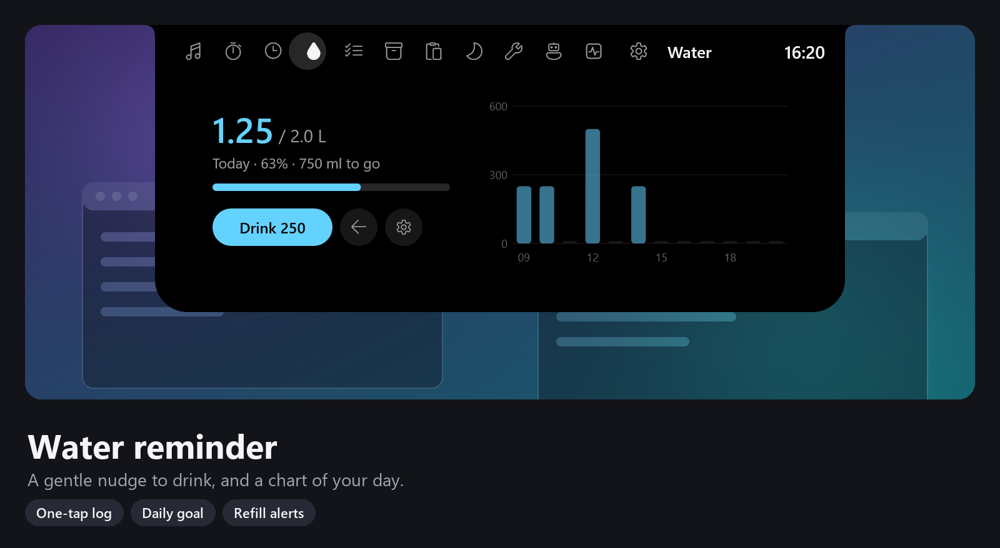

- **Drink** logs one sip. The arrow button undoes the last one.
- The chart shows what you drank each hour today.
- Reminders are spread evenly across your active hours until you reach your goal. Each one offers **Drank** or **Snooze**.
- When you have drunk a bottle's worth, it asks you to refill.

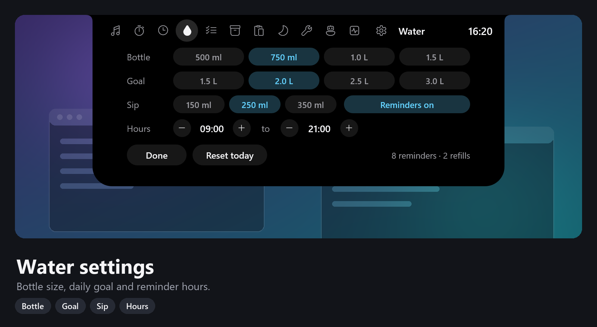

The gear button opens settings: bottle size, daily goal, sip size, active hours and reminders on or off. **Reset today** asks before clearing.

## Prayer times

- Today's Fajr, Sunrise, Dhuhr, Asr, Maghrib and Isha, with the next prayer, a countdown and the current prayer highlighted.
- Times are calculated on your PC from the sun's position for your place and date, so they follow the seasons and need no internet. They use your PC's time zone.
- The **bell** beside a prayer turns its reminder on. Reminders are off until you turn them on.
- The gear opens three pages:
  - **Location**: one of 16 Bangladesh cities, or **Custom location** to type a latitude and longitude (for example `23.81, 90.41`) and press Enter.
  - **Method**: Karachi (University of Islamic Sciences, the usual choice in Bangladesh), MWL, ISNA, Egypt or Makkah; Shafi or Hanafi Asr; reminders on time or 5, 10 or 15 minutes before; and a countdown in the closed notch for the last 15 minutes before a prayer.
  - **Adjust**: move any prayer a minute earlier or later (up to 30) to match your mosque or calendar.
- The default is Dhaka, Karachi method, Hanafi Asr.

## AI agents

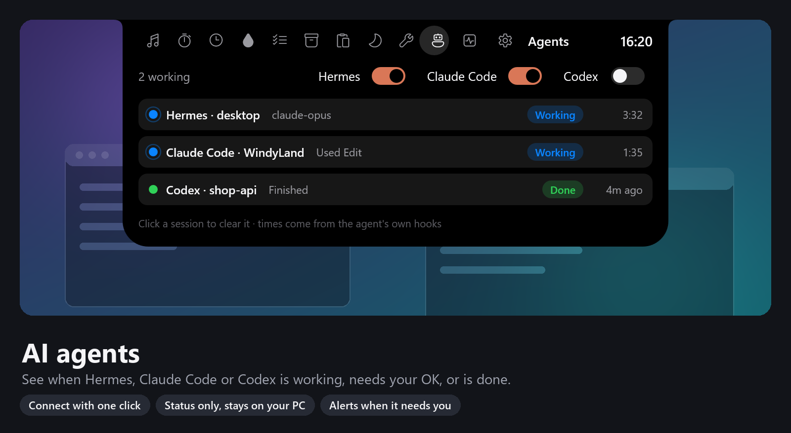

If you use **Hermes**, **Claude Code** or **Codex CLI**, the notch shows what they're doing while you're in another window.

- Open the **AI agents** tab and switch on **Hermes**, **Claude Code** and/or **Codex**. WindyLand adds a hook to the agent's own settings: Hermes shell hooks through `hermes config set` (and Hermes' hook allowlist, so it doesn't ask again), `~/.claude/settings.json`, `~/.codex/config.toml`. Hermes picks it up within a minute; Claude Code and Codex from their next session. Switching it off removes exactly what was added, and so does uninstalling WindyLand.
- **Working**: the closed notch shows the agent icon and how long it has been at it, with the project folder on the other side.
- **Needs you**: when Hermes wants your OK for a command, asks a question or needs a password, or Claude Code asks for permission, the notch pops up (with your chime) and turns orange until you answer.
- **Done**: a short "finished, took 3 min" notice when a turn ends. Codex reports only this one. Stopping Hermes with Esc shows Stopped, without a notice.
- The tab lists recent sessions; click one to clear it. A session that goes quiet for 20 minutes (you pressed Esc, say) drops back to Ready.
- Privacy: the hook passes on only the event name, session id, project folder (or where Hermes runs, like desktop), model and tool name, and the agent's notice text. Prompts, code and tool output are never read or stored, and nothing leaves your PC. If Codex already runs its own `notify` program, WindyLand leaves it alone and says so.

## System monitor

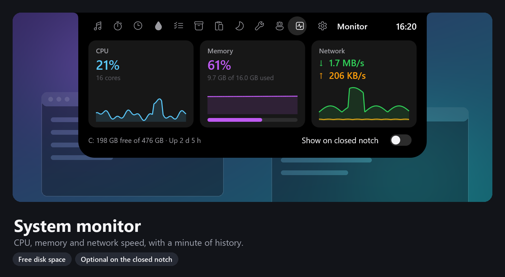

- **CPU**, **memory** and **network** (download and upload) with a one-minute graph, plus free space on the Windows drive and how long the PC has been on.
- CPU, memory and download speed are also widgets: switch them on in the **Widgets** tab to keep them on the closed notch.
- It reads Windows' own counters once a second, so it adds no load.

## Widgets: what the closed notch shows

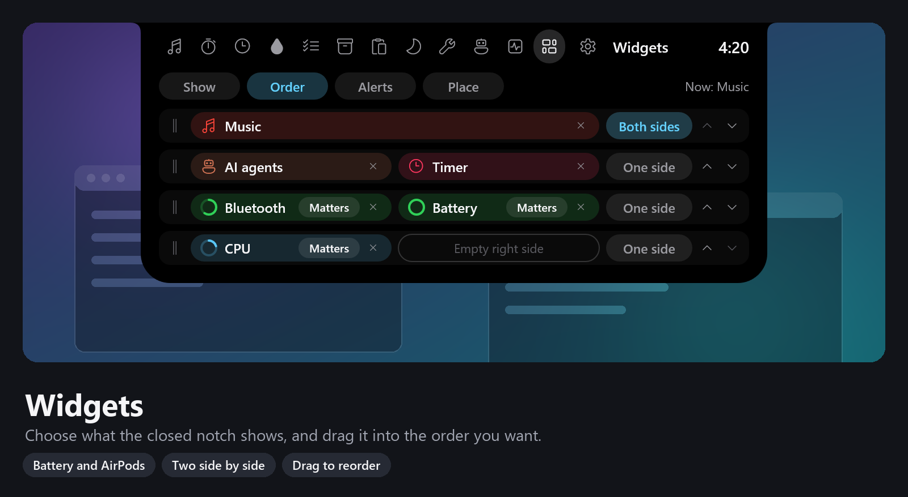

The **Widgets** tab decides what the closed notch shows. It has four pages; most people only need the first. The Show and Order pages open a little taller, to fit their lists.

### Show (simple)

Click a card to switch it on or off. The cards come in three groups:
- **Live activities**, shown only while they run: Music, Timer, Pomodoro, Prayer countdown, Due tasks, AI agents.
- **System**: Battery, Bluetooth (a connected device's battery), Weather, Wi-Fi, Volume, Microphone, CPU, Memory, Network, Free space, Uptime, Date.
- **From your panels**: Water, Focus today, Tasks, Next prayer.

WindyLand puts them in order for you. Whatever is running wins, the most urgent first (an AI agent that needs your OK goes above music). When nothing is running, your widgets show, two at a time, around the clock.

**Only when it matters** (on by default) hides a widget with nothing to say: the battery on the charger, good Wi-Fi, sound that isn't muted, Water once the goal is reached, no open tasks.

**Reset to default** puts back the default items and order. Click it twice: the first click asks.

### Order (advanced)

Switch on **Custom order** to arrange things yourself on the **Order** page. The notch reads its rows from the top and shows the first one with something to show:
- A **Both sides** row uses both sides of the clock (music: art, clock, equaliser).
- A **One side** row holds two items, one on each side of the clock (`[art ▮▮]  4:20  [🤖 3:44]`).
- **Drag** an item onto an empty side to pair it, onto another item to swap them, or between two rows to give it a row of its own. Drag a row by its handle, or use ▲ ▼.
- If a one-side row has an empty or idle side, the next one-side item below with something to show fills it.
- **×** removes an item.
- Each widget has a **when to show** tag. Click it to change: **Always**, **Matters** (only when it has something to say), or **Changes** (for a few seconds after its value changes).

Examples:
- **Music** above **AI agents**: only the song while it plays; the agent once it stops. Swap them to see the agent on top of the song. Make both **One side** in one row to see both at once.
- **Music** both sides, then **Volume** set to **Changes**: the song stays; volume appears when you change it. (Or use the Alerts page below.)

Turning Custom order off keeps your order for later.

### Alerts

Each alert (Volume, Copied, Battery, Network, Caps Lock, Language, Bluetooth, Mic & camera) can be:
- **Off**,
- **Small**: a few seconds inside the closed notch, on the right of what it shows (music stays on the left), and nothing opens,
- **Pop-up**: the card that drops out of the notch (the default).

Volume and Copied are the same settings as **Volume overlay** and **Show what I copy** in Settings. Notifications, reminders and timers, which have buttons, stay pop-ups.

### Place

Where you are, for the **Weather** (and prayer times, if you switch on **Use it for prayer times too**):
- **Auto (time zone)**: the main city of Windows' time zone. Works offline and isn't fooled by a VPN, but it's only a city per time zone.
- **Windows location**: Windows' location service. It needs **Settings > Privacy & security > Location > Let desktop apps access your location**. On a PC without GPS, Windows may itself guess from your network, so a VPN can move it.
- **Choose a city**: type a city, press Enter and pick it. Searching asks [Open-Meteo](https://open-meteo.com).

The page always shows the place in use, by name, so you can see when it's wrong.

### Notes

- A panel turned off in **Settings > Panels** drops out of the Widgets tab too.
- Clicking the closed notch opens the panel of what it's showing.
- With the mascot in the **Slim** style: in the middle it takes the clock's place; at the left or right it takes that side, and the notch stays the same size. Only beside an item using both sides does the notch grow to make room.
- **Bluetooth** shows the battery Windows knows for connected headsets, mice and keyboards. AirPods don't share theirs with Windows, so WindyLand listens for about 3 seconds once a minute to the battery broadcast AirPods send (left, right and case, in 10% steps). It only does this while the Bluetooth widget is on (or the Widgets tab is open) and AirPods are connected. Nothing is saved or sent. In a crowded place it may sometimes pick up someone else's AirPods.
- **Weather** is the only widget that goes online by itself: while it's on, WindyLand asks Open-Meteo about every 30 minutes, with the place rounded to about 10 km. Temperatures are in °C; switch to °F on the **Place** page.
- **Wi-Fi** shows the signal, and the network's name when Windows allows it (the same location setting as above).

## Calendar

The **Calendar** tab shows the month. Today has a red circle; days with to-do tasks due get a small dot (yellow while one is still open).
- **‹ ›** (or the mouse wheel over the panel) go to the previous or next month; **Today** jumps back.
- Click a day to see it on the right: how far away it is, and the tasks due that day with their times. Clicking a greyed day from the month before or after goes there.
- The week starts on the day set in Windows' region settings.

## Themes and seconds

**Settings > Look** has the themes and the seconds switch.
- **Themes**: **Black** (the default), **Graphite**, **Midnight**, **Rose**, **Forest**, **Ocean**, **Light**, **Blossom** (light pink), **Paper** (old paper) and **Liquid Glass**. A theme changes the notch and every panel. On the light themes, coloured labels are a little darker so they stay readable.
- **Liquid Glass** shows a blurred view of what's behind the notch under a clear tint, with a bright edge. Over a bright window it turns into light glass with dark text, over a dark one into dark glass with white text. To see behind itself, the notch is left out of screenshots and screen sharing while Liquid Glass is on (the other themes aren't).
- **Show seconds** puts seconds on the clock (4:20:15). The Slim and Compact notches get a little wider so nothing gets squeezed.

## Tools

The Tools tab has four small tools; the chips at the top switch between them. Everything works offline.

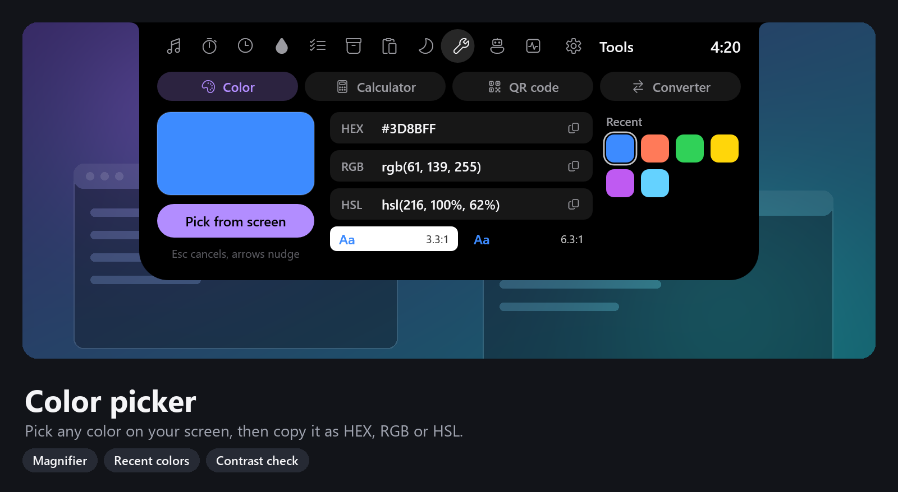

- **Color picker**: **Pick from screen**, then click anywhere. A magnifier under the cursor shows the exact pixel; arrow keys move it one pixel (Shift for ten), and Esc or a right-click cancels. The color is copied as HEX straight away; click HEX, RGB or HSL to copy that form instead. It also shows how readable text in that color is on white and on black, and keeps your last eight colors.

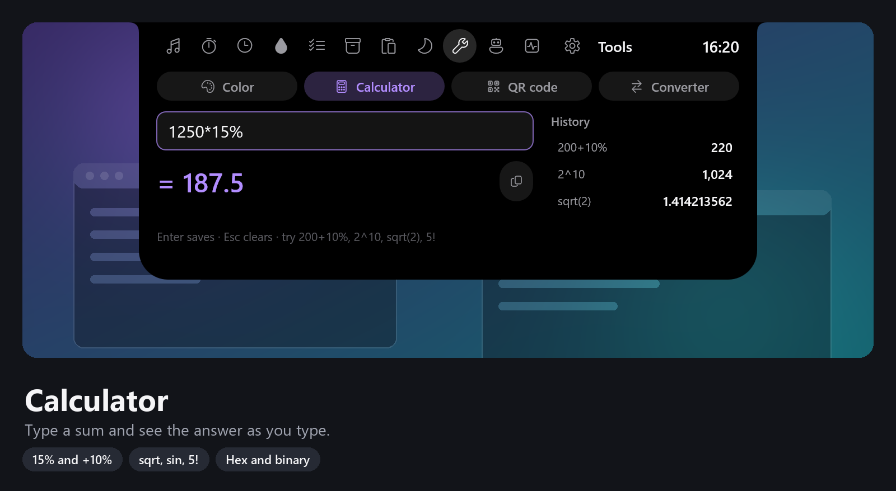

- **Calculator**: type a sum and the answer appears as you type. `1250*15%` is 15 % of 1250, `200+10%` adds 10 %, and `2^10`, `sqrt(2)`, `sin(30)` (degrees), `5!`, `pi`, `0xFF` and `0b1010` work too. Enter keeps the result in the history (click one to reuse it), Esc clears, Ctrl+C copies the answer.

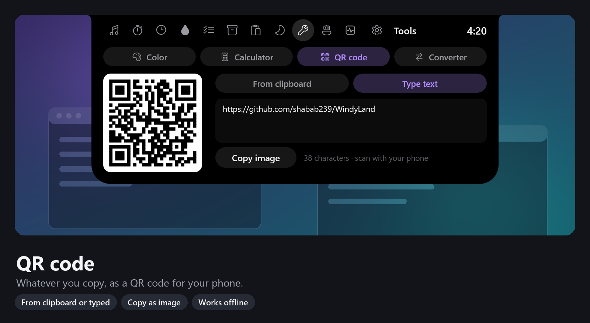

- **QR code**: shows what you last copied as a QR code, so a link gets to your phone with one scan. **Type text** makes one from your own text, and **Copy image** puts the code on the clipboard as a picture.

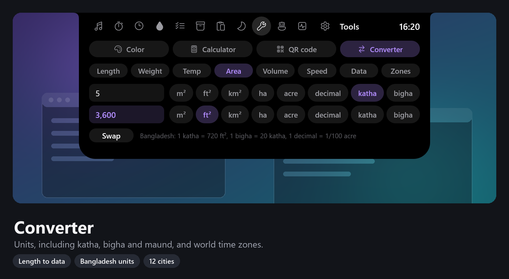

- **Converter**: length, weight, temperature, area, volume, speed and data. It includes Bangladesh's units: katha (720 ft²), bigha (20 katha), decimal (1/100 acre), maund (40 seer), seer and tola (vori). Type a number (or a sum), click the units, **Swap** flips them, and clicking the answer copies it.
- **Zones** shows the time in 12 cities (Dhaka, Kolkata, Dubai, Riyadh, London, Paris, New York, Toronto, Los Angeles, Tokyo, Sydney, Kuala Lumpur), using Windows' own daylight-saving rules. Click a city to compare from it, and use the hour buttons to see "what time will it be there at 6 pm here".

## File shelf

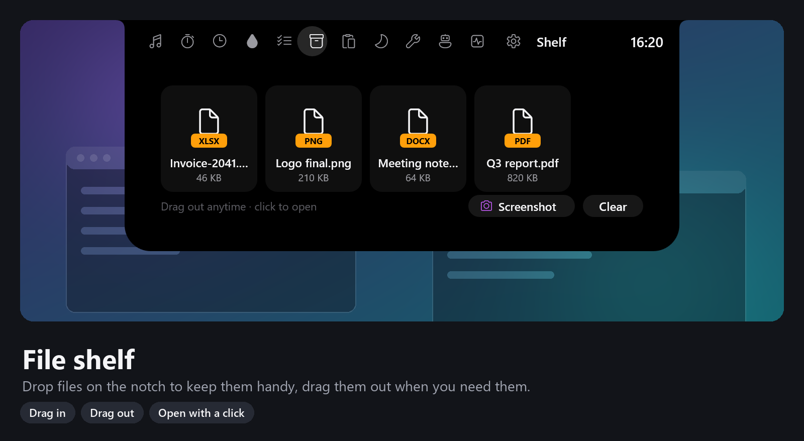

- **Drag files, folders or browser links onto the notch.** It opens the Shelf and shows *Release to add*.
- **Click** an item to open it. **Drag** it out into a chat, an email or a folder.
- Hover an item and click the **x** to remove it. **Clear** empties the shelf.
- The shelf keeps links to your files, not copies.
- **Screenshot**: the notch hides and the screen freezes; drag over the part you want (or just click for the whole screen), Esc cancels. The picture is saved as a PNG in **Pictures\Screenshots**, added to the Shelf (drag it into a chat) and copied to the clipboard.

## Clipboard history

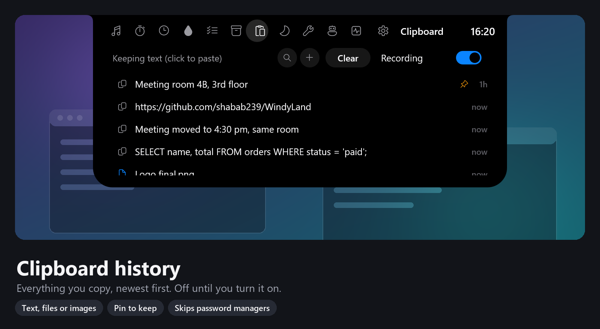

- Clipboard history is **off** until you turn it on: open the **Clipboard** tab and click **Turn on clipboard history**, or use the switch in Settings.
- **What it records** (Settings > Clipboard history): **Text** (the default), **Text + files** (files you copy in Explorer), or **Everything** (also pictures, shown as thumbnails).
- What you copy appears here, newest first. The last 30 are kept, and up to 10 pictures.
- **Search** (magnifier icon): type to filter the history; **Enter** pastes the first match, **Esc** clears, Esc again closes.
- **Snippets** (+ icon): type text you paste often (your address, bKash number, an email signature) and press Enter. It's kept like a pinned entry, even with recording off.
- **Click** an entry to paste it straight into the app you were using (it presses Ctrl+V for you). Hold **Shift** while clicking to paste as plain text in apps that support Ctrl+Shift+V. Files paste into Explorer too.
- To only copy it, hover the entry and click the **copy** icon; then paste wherever you like with Ctrl+V.
- Apps running as administrator don't accept typing from normal apps, so for those the entry is only copied and the notch says **press Ctrl+V**.
- Hover an entry to **copy** it without pasting, **pin** it (pinned entries stay at the top and are kept after a restart) or **remove** it. **Clear** removes everything that isn't pinned. The switch in the tab header stops and starts recording.
- **Show what I copy** (Settings > Privacy, off by default): every time you copy something, a small toast shows it for two seconds, like on Android: the text, the file names, or a thumbnail of the picture. It works even with clipboard history off and keeps nothing. WindyLand's own copies (pasting an entry, a color, a screenshot) don't show.
- Privacy: unpinned entries and all pictures live in memory only and are gone when WindyLand exits. Pinned text and files are saved in `clipboard.txt`. Passwords and codes copied from password managers that mark them private (KeePass, Bitwarden, 1Password and others) are never recorded.

## Mic and camera dots

- While any app is using your **microphone**, an orange dot appears beside the notch; a green dot means the **camera** is on. The notch also drops a short notice naming the app when it starts.
- The dots show in every notch style, including Pill and Hidden, and next to the clock when the panel is open.
- WindyLand reads this from Windows' own privacy records; it does not listen to or watch anything itself. Turn the dots off with **Mic & camera dots** in Settings.

## Windows notifications in the notch

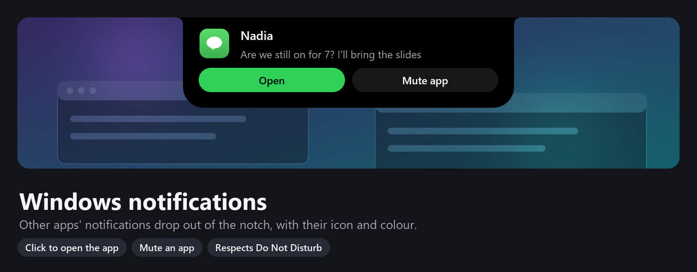

WindyLand can show other apps' notifications (messages, mail, calendar, browser sites) in the notch, with the app's icon and colour, instead of Windows' banner in the corner.

- Turn it on in **Settings > Privacy > Show them in the notch**. It's off until you do.
- Windows keeps showing its own banner too, unless you turn banners off: click **Windows banners** in the same place (or open Windows **Settings > System > Notifications**) and turn off **Show notification banners** for the apps you want in the notch only. Notifications still go to Notification Center as usual.
- **Click** a notification (or **Open**) to open the app that sent it. **Mute app** stops that app's notifications appearing in the notch; **Unmute** in Settings brings them all back. Buttons inside a notification (Reply, Accept) only work in Windows' own banner.
- **Include message text** off shows only the app's name, handy if you share your screen.
- Notifications that arrive while **Do Not Disturb** or focus is on, or during a full-screen game or video, wait until it's over, then the newest shows with a count of the rest ("+2 more"). Windows 11 turns focus on by itself during games and full-screen apps.
- How it works: WindyLand asks Windows for the notifications in Notification Center, the same permission other notification tools use (Windows **Settings > Privacy & security > Notifications**). It checks only when Windows records a new one. Nothing is stored or sent anywhere.

## Alerts and overlays

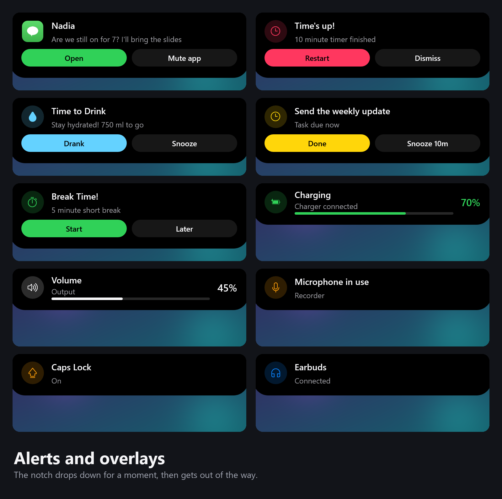

The notch briefly drops down for:

- charger connected or unplugged, low battery (20%), critical battery (10%) and fully charged
- internet connected, no internet access, or disconnected
- Caps Lock on or off, and keyboard language changes
- volume changes (turn off with **Volume overlay** in Settings)
- Bluetooth devices connecting or disconnecting

## The mascot

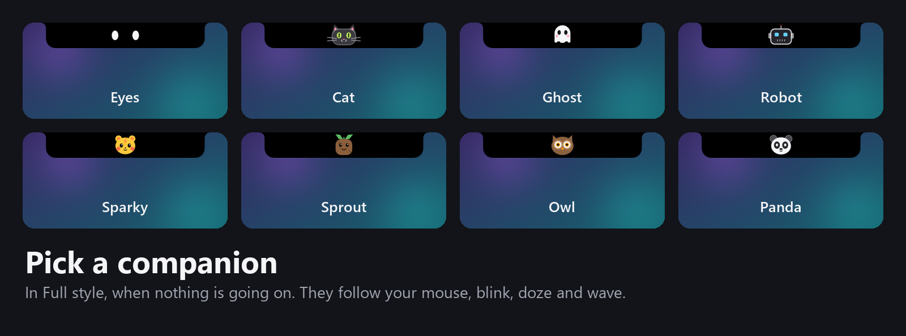

In the **Full** style, after a while with nothing going on, the clock turns into a little companion that follows your mouse with its eyes. After two minutes away it dozes off, and it waves when you come back.

Pick one in **Settings > Mascot**: Eyes, Cat, Ghost, Robot, Sparky (an electric hamster), Sprout (a tiny tree), Owl or Panda. Hover a tile to see it wave. **Clock** turns the mascot off.

- **Always** shows the mascot all the time instead of waiting for a quiet moment, even next to music or a timer.
- **Left**, **Center** or **Right** places it in the notch. At the left or right, the clock (or the music, timer or prayer countdown) sits beside it; the notch grows a little to make room. This applies on the top and bottom edges.
- **Taskbar** moves the mascot onto the Windows taskbar instead, into the empty corner where the Widgets weather goes (to the right of the weather if you have it on). The notch at the screen edge then hides:
  - **Hover** the mascot and the panel opens right above it; move away and it closes. **Click** opens it too, **right-click** opens Settings.
  - Alerts (timers, reminders, notifications) pop up above the mascot.
  - With the taskbar icons on the left, the corner holds Start, so the mascot sits just left of the clock instead.
  - With an auto-hidden taskbar, or during a full-screen game or video, the mascot hides and the notch comes back to its usual place.
  - To go back to the notch, click **Taskbar** again, or pick a style or position (or right-drag the notch).

## Settings and your data

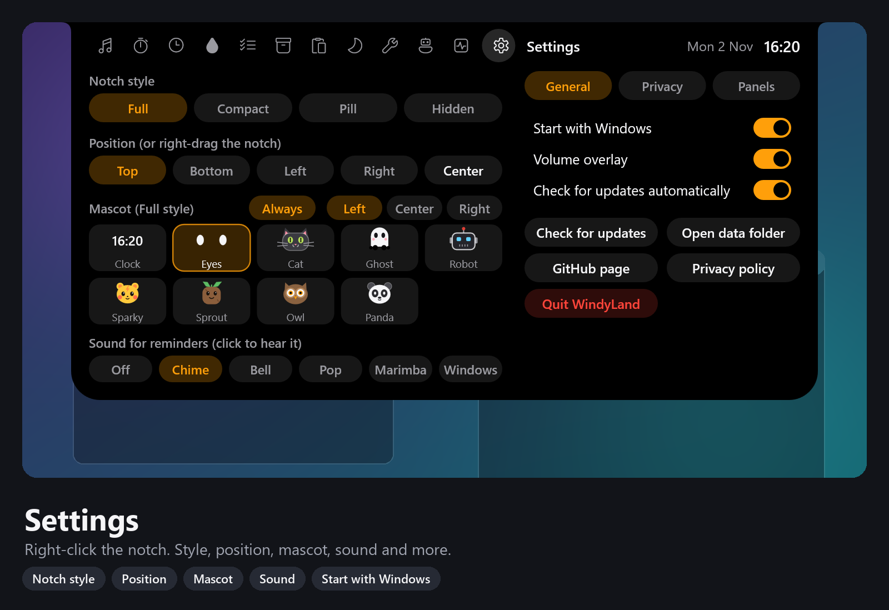

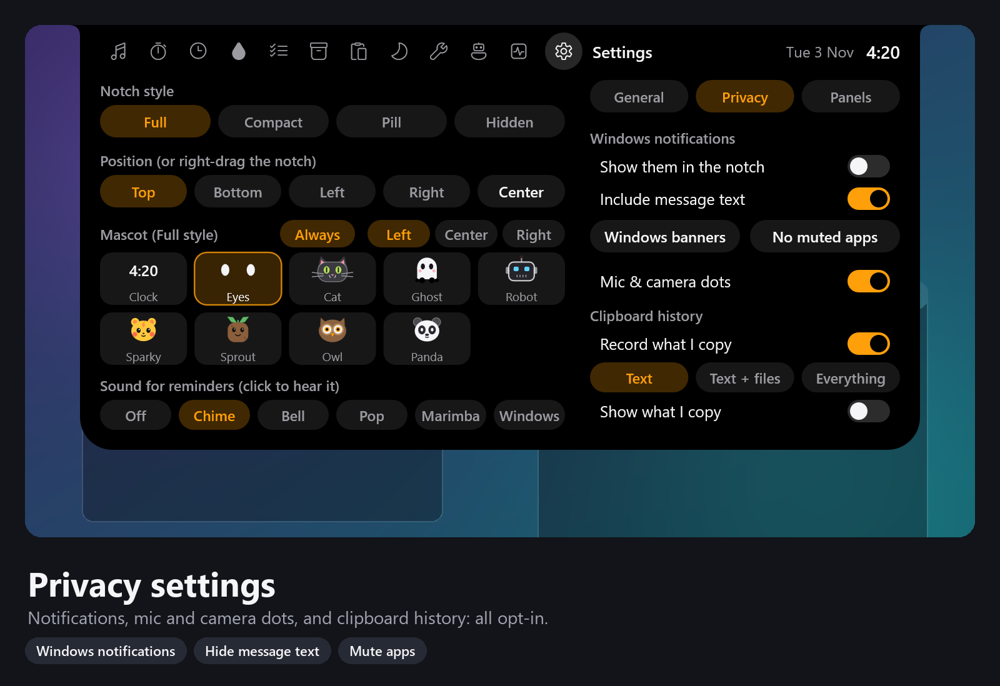

Open Settings with the **gear** at the end of the tab bar, a plain **right-click** on the notch, or a **left-click** on the tray icon. The notch opens into a large settings panel. Style, position, mascot and sound are on the left; the right side has three pages, **General**, **Privacy** and **Panels**:

| Item | What it does |
|---|---|
| Notch style | Full, Compact, Pill or Hidden |
| Position | Top, Bottom, Left, Right, Center |
| Mascot | Which companion shows, or Clock for none; **Always** and **Left / Center / Right** |
| Sound for reminders | Chime, Bell, Pop, Marimba, Windows (your system sound) or Off; picking one plays it |
| **General** page: Start with Windows | Launch at sign-in |
| Volume overlay | Show volume changes |
| 12-hour clock | 4:20 PM (the default) or 16:20, everywhere in WindyLand |
| Step aside for windows under it | Smart hide: steps aside while a window's top is under the notch, comes back after a moment, steps aside when the mouse is near (on by default) |
| Check for updates | Looks for a newer version now |
| Check for updates automatically | Asks GitHub for the latest version about twice a day. On by default; also offered by the installer |
| Open data folder | Opens `%APPDATA%\WindyLand` |
| GitHub page / Privacy policy / Quit WindyLand | The privacy policy is [PRIVACY.md](../PRIVACY.md) |
| **Privacy** page: Windows notifications | Show them in the notch, include message text, Windows banners, unmute apps |
| Mic & camera dots | Dots while the mic or camera is in use |
| Clipboard history | Record on/off, and Text, Text + files or Everything |
| Show what I copy | A small preview of each copy (off by default) |
| **Panels** page | Show or hide each panel. A hidden panel is off: no tab and no reminders. One always stays |

Right-clicking the tray icon shows a short menu: Settings, Welcome tour, Check for updates, About and Exit. Resting the mouse on any icon button shows what it does.

Everything is stored as plain text in `%APPDATA%\WindyLand` (`settings.txt`, `todo.txt`, `water.txt`, `prayer.txt`, `tools.txt`, `shelf.txt`, `clipboard.txt`). Uninstalling from **Settings > Apps** asks whether to delete it too.

## Uninstalling

- **Settings > Apps > WindyLand > Uninstall**, as usual, or **Uninstall WindyLand...** in the tray icon's menu.
- The tray item works even where Windows blocks the unsigned uninstaller (Smart App Control). It asks whether to keep your data, closes WindyLand, takes it out of startup, disconnects Claude Code and Codex, then removes the app. From a command line: `windyland.exe --uninstall` (`--keep-data`, `--quiet`).
- Screenshots in Pictures\Screenshots are never deleted.

## Updates

WindyLand checks GitHub for a new version shortly after it starts and then twice a day. When there is one, the notch shows **Update available**:

- **Update** downloads the installer, upgrades in place and starts the new version. Your data and settings stay.
- **Later** asks again at the next check.
- **Skip** ignores that version (newer ones are still offered).

To check yourself, open Settings and click **Check for updates**. The check only asks GitHub for the latest release number; nothing about you is sent. If GitHub is busy or you're offline, it tries again within the hour. Before running a downloaded update, WindyLand checks it against the fingerprint (SHA-256) GitHub publishes for it.

## Troubleshooting

- **Nothing in Now playing.** Make sure the player shows up in the Windows media overlay (press a media key and look at the volume flyout).
- **The notch disappeared.** It hides while a full-screen game, video or presentation is running, and comes back as soon as you leave it. Reminders that arrive meanwhile wait and show (with their sound) when it returns.
- **It opens when I reach for my tabs.** Switch to the Compact, Pill or Hidden style, or move it to another edge.
- **Found a bug or have an idea?** Open an [issue](https://github.com/shabab239/WindyLand/issues/new/choose); the form asks for what helps.
- **Lyrics not available.** The song is not on LRCLIB yet, or the title from the player is too unusual to match.
