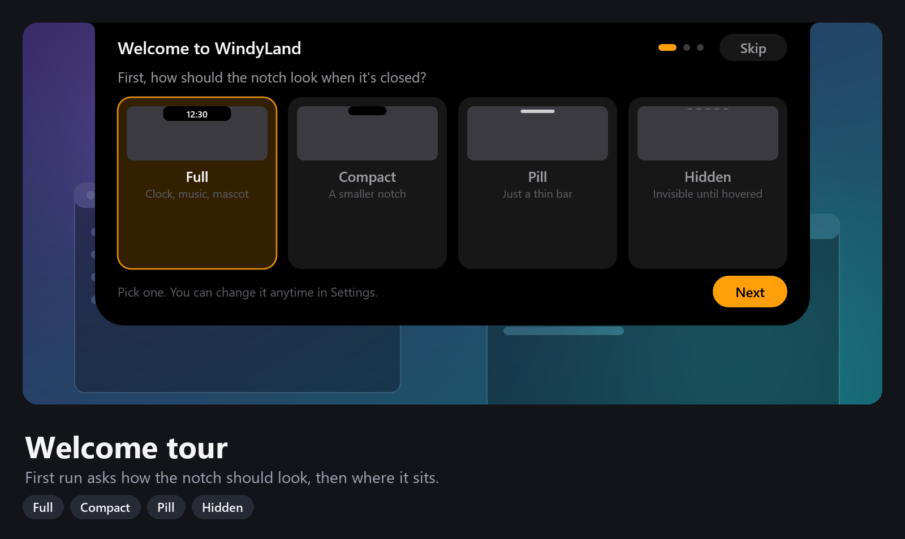
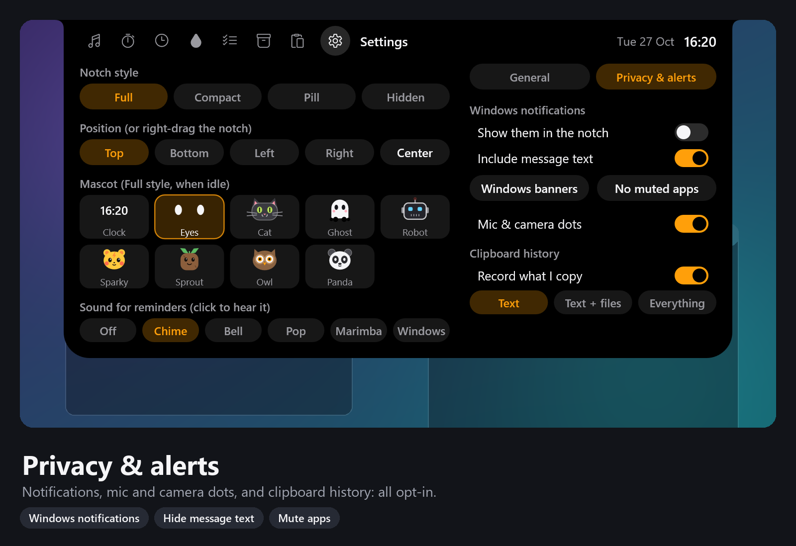

# WindyLand user guide

- [Getting started](#getting-started)
- [Open and close](#open-and-close)
- [Move it to any edge](#move-it-to-any-edge)
- [Notch styles](#notch-styles)
- [Now playing and lyrics](#now-playing-and-lyrics)
- [Timer and stopwatch](#timer-and-stopwatch)
- [Pomodoro](#pomodoro)
- [To-do with reminders](#to-do-with-reminders)
- [Water reminder](#water-reminder)
- [Prayer times](#prayer-times)
- [File shelf](#file-shelf)
- [Clipboard history](#clipboard-history)
- [Mic and camera dots](#mic-and-camera-dots)
- [Windows notifications in the notch](#windows-notifications-in-the-notch)
- [Alerts and overlays](#alerts-and-overlays)
- [The mascot](#the-mascot)
- [Settings and your data](#settings-and-your-data)
- [Updates](#updates)
- [Troubleshooting](#troubleshooting)

## Getting started

1. Run `WindyLandSetup-<version>.exe`. Tick **Start WindyLand when Windows starts** if you like.
2. The notch opens with a short **welcome tour**: pick how it looks when closed (Full, Compact, Pill or Hidden), pick the screen edge, read three quick tips (hover to open, the mouse wheel switches panels, right-drag to move it), and see what's in Settings at a glance. **Open Settings** on the last step goes straight there. You can skip it, and replay it later from the tray icon's menu (**Welcome tour**). Everything you pick can be changed later in Settings.

   

3. A tray icon (a pill with two eyes) appears near the clock.
4. To quit, right-click the tray icon and choose **Exit**, or use **Quit WindyLand** in Settings.

## Open and close

- **Hover** the notch to open it. Move the mouse away and it closes.
- **Click** the notch to open it straight away.
- The icons along the top of the open panel switch between features. The **mouse wheel** does too: roll down for the next panel, up for the previous one. On a list that scrolls (to-do, clipboard, lyrics) the wheel scrolls the list; over the icons it always switches.
- Don't use a panel? Hide it in **Settings > Panels**.
- The smaller styles (Compact, Pill, Hidden) wait a moment before opening, so reaching for browser tabs does not open them by accident.

## Move it to any edge

- **Right-click and drag** the notch. It snaps to the nearest edge of whichever screen the mouse is on: top, bottom, left or right. Let go to place it.
- Or open **Settings** and pick an edge under **Position**. **Center** puts it back in the middle.
- On the left and right edges the closed notch becomes a vertical tab. Panels always open upright.
- A plain right-click (without dragging) opens Settings.

## Notch styles

Open **Settings** and pick one under **Notch style**:

| Style | Looks like | Best for |
|---|---|---|
| Full | Black notch with the clock, music and timers | Seeing everything at a glance |
| Compact | A smaller notch | Less space, still glanceable |
| Pill | A thin bar, tinted while music or a timer runs | Almost invisible |
| Hidden | Nothing | Rest the mouse at the edge to open |

## Now playing and lyrics

- Works with anything that shows in the Windows media overlay: Spotify, YouTube and other sites in Chrome, Edge or Firefox, Media Player and more.
- **Click the progress bar** to seek. Use the previous, play/pause and next buttons.
- **Lyrics**: click the lines button on the right. The panel splits and the current line lights up. Click a line to jump to it, or scroll to look ahead.
- When music plays, the closed notch shows the album art and a small equaliser.
- Some songs have no lyrics on LRCLIB yet; the panel then says *Lyrics not available*.

## Timer and stopwatch

**Countdown**

1. Open the **Timer** tab (the clock icon).
2. Pick a preset (1 min to 1 h) or use **-1 min** / **+1 min**. While it is stopped you can also scroll over the panel to change it by a minute.
3. Press **Start**. The time left and *Ends at* show in the panel, and a countdown ring stays in the closed notch.
4. **+1 min / -1 min** also work while it is running, without restarting.
5. When it finishes it chimes and drops an alert with **Restart** and **Dismiss**.

WindyLand remembers your last duration.

**Stopwatch**: switch to **Stopwatch**, then **Start**, **Lap** and **Reset**. Laps show the split and the total.

## Pomodoro

- 25 minutes of focus, then a 5 minute break. Every fourth break is 15 minutes.
- **Start / Pause**, **Reset** and **Skip** control the current phase.
- At the end of each phase it chimes and offers **Start** for the next one, or **Later**.
- The dots show your progress through the cycle of four.

## To-do with reminders

- **Add Task**, type a title, and optionally give it a time.
- Click a task to edit it. Click the circle to tick it off. Hover a task to delete it.
- When a task is due, the notch drops down with **Done** and **Snooze 10m**.
- Tasks you complete are cleared the next day. **Clear done** removes them now.

**Setting a time:** tap **+15m**, **+30m**, **+1h** or **+2h** (they add up), then fine-tune with **-** and **+**. **No time** means no reminder. Press **Enter** to save or **Esc** to cancel. You can paste with **Ctrl+V**.

## Water reminder

- **Drink** logs one sip. The arrow button undoes the last one.
- The chart shows what you drank each hour today.
- Reminders are spread evenly across your active hours until you reach your goal. Each one offers **Drank** or **Snooze**.
- When you have drunk a bottle's worth, it asks you to refill.

The gear button opens settings: bottle size, daily goal, sip size, active hours and reminders on or off. **Reset today** asks before clearing.

## Prayer times

- Today's Fajr, Sunrise, Dhuhr, Asr, Maghrib and Isha, with the next prayer, a countdown and the current prayer highlighted.
- Times are calculated on your PC from the sun's position for your place and date, so they follow the seasons and need no internet. They use your PC's time zone.
- The **bell** beside a prayer turns its reminder on. Reminders are off until you turn them on.
- The gear opens three pages:
  - **Location**: one of 16 Bangladesh cities, or **Custom location** to type a latitude and longitude (for example `23.81, 90.41`) and press Enter.
  - **Method**: Karachi (University of Islamic Sciences, the usual choice in Bangladesh), MWL, ISNA, Egypt or Makkah; Shafi or Hanafi Asr; reminders on time or 5, 10 or 15 minutes before; and a countdown in the closed notch for the last 15 minutes before a prayer.
  - **Adjust**: move any prayer a minute earlier or later (up to 30) to match your mosque or calendar.
- The default is Dhaka, Karachi method, Hanafi Asr.

## File shelf

- **Drag files, folders or browser links onto the notch.** It opens the Shelf and shows *Release to add*.
- **Click** an item to open it. **Drag** it out into a chat, an email or a folder.
- Hover an item and click the **x** to remove it. **Clear** empties the shelf.
- The shelf keeps links to your files, not copies.

## Clipboard history

- Clipboard history is **off** until you turn it on: open the **Clipboard** tab and click **Turn on clipboard history**, or use the switch in Settings.
- **What it records** (Settings > Clipboard history): **Text** (the default), **Text + files** (files you copy in Explorer), or **Everything** (also pictures, shown as thumbnails).
- What you copy appears here, newest first. The last 30 are kept, and up to 10 pictures.
- **Click** an entry to copy it again, then paste with **Ctrl+V** as usual. Copied files paste into Explorer too.
- Hover an entry to **pin** it (pinned entries stay at the top and are kept after a restart) or **remove** it. **Clear** removes everything that isn't pinned. The switch in the tab header stops and starts recording.
- Privacy: unpinned entries and all pictures live in memory only and are gone when WindyLand exits. Pinned text and files are saved in `clipboard.txt`. Passwords and codes copied from password managers that mark them private (KeePass, Bitwarden, 1Password and others) are never recorded.

## Mic and camera dots

- While any app is using your **microphone**, an orange dot appears beside the notch; a green dot means the **camera** is on. The notch also drops a short notice naming the app when it starts.
- The dots show in every notch style, including Pill and Hidden, and next to the clock when the panel is open.
- WindyLand reads this from Windows' own privacy records; it does not listen to or watch anything itself. Turn the dots off with **Mic & camera dots** in Settings.

## Windows notifications in the notch

WindyLand can show other apps' notifications (messages, mail, calendar, browser sites) in the notch, with the app's icon and colour, instead of Windows' banner in the corner.

- Turn it on in **Settings > Privacy > Show them in the notch**. It's off until you do.
- Windows keeps showing its own banner too, unless you turn banners off: click **Windows banners** in the same place (or open Windows **Settings > System > Notifications**) and turn off **Show notification banners** for the apps you want in the notch only. Notifications still go to Notification Center as usual.
- **Click** a notification (or **Open**) to open the app that sent it. **Mute app** stops that app's notifications appearing in the notch; **Unmute** in Settings brings them all back. Buttons inside a notification (Reply, Accept) only work in Windows' own banner.
- **Include message text** off shows only the app's name, handy if you share your screen.
- Notifications that arrive while **Do Not Disturb** or focus is on, or during a full-screen game or video, wait until it's over, then the newest shows with a count of the rest ("+2 more"). Windows 11 turns focus on by itself during games and full-screen apps.
- How it works: WindyLand asks Windows for the notifications in Notification Center, the same permission other notification tools use (Windows **Settings > Privacy & security > Notifications**). It checks only when Windows records a new one. Nothing is stored or sent anywhere.

## Alerts and overlays

The notch briefly drops down for:

- charger connected or unplugged, low battery (20%), critical battery (10%) and fully charged
- internet connected, no internet access, or disconnected
- Caps Lock on or off, and keyboard language changes
- volume changes (turn off with **Volume overlay** in Settings)
- Bluetooth devices connecting or disconnecting

## The mascot

In the **Full** style, after a while with nothing going on, the clock turns into a little companion that follows your mouse with its eyes. After two minutes away it dozes off, and it waves when you come back.

Pick one in **Settings > Mascot**: Eyes, Cat, Ghost, Robot, Sparky (an electric hamster), Sprout (a tiny tree), Owl or Panda. Hover a tile to see it wave. **Clock** turns the mascot off.

- **Always** shows the mascot all the time instead of waiting for a quiet moment, even next to music or a timer.
- **Left**, **Center** or **Right** places it in the notch. At the left or right, the clock (or the music, timer or prayer countdown) sits beside it; the notch grows a little to make room. This applies on the top and bottom edges.

## Settings and your data

Open Settings with the **gear** at the end of the tab bar, a plain **right-click** on the notch, or a **left-click** on the tray icon. The notch opens into a large settings panel. Style, position, mascot and sound are on the left; the right side has three pages, **General**, **Privacy** and **Panels**:

| Item | What it does |
|---|---|
| Notch style | Full, Compact, Pill or Hidden |
| Position | Top, Bottom, Left, Right, Center |
| Mascot | Which companion shows, or Clock for none; **Always** and **Left / Center / Right** |
| Sound for reminders | Chime, Bell, Pop, Marimba, Windows (your system sound) or Off; picking one plays it |
| **General** page: Start with Windows | Launch at sign-in |
| Volume overlay | Show volume changes |
| Check for updates | Looks for a newer version now |
| Check for updates automatically | Asks GitHub for the latest version about twice a day. On by default; also offered by the installer |
| Open data folder | Opens `%APPDATA%\WindyLand` |
| GitHub page / Privacy policy / Quit WindyLand | The privacy policy is [PRIVACY.md](../PRIVACY.md) |
| **Privacy** page: Windows notifications | Show them in the notch, include message text, Windows banners, unmute apps |
| Mic & camera dots | Dots while the mic or camera is in use |
| Clipboard history | Record on/off, and Text, Text + files or Everything |
| **Panels** page | Show or hide each panel. A hidden panel is off: no tab and no reminders. One always stays |

Right-clicking the tray icon shows a short menu: Settings, Welcome tour, Check for updates, About and Exit. Resting the mouse on any icon button shows what it does.

Everything is stored as plain text in `%APPDATA%\WindyLand` (`settings.txt`, `todo.txt`, `water.txt`, `prayer.txt`, `shelf.txt`, `clipboard.txt`). Uninstalling from **Settings > Apps** asks whether to delete it too.

## Updates

WindyLand checks GitHub for a new version shortly after it starts and then twice a day. When there is one, the notch shows **Update available**:

- **Update** downloads the installer, upgrades in place and starts the new version. Your data and settings stay.
- **Later** asks again at the next check.
- **Skip** ignores that version (newer ones are still offered).

To check yourself, open Settings and click **Check for updates**. The check only asks GitHub for the latest release number; nothing about you is sent. If GitHub is busy or you're offline, it tries again within the hour. Before running a downloaded update, WindyLand checks it against the fingerprint (SHA-256) GitHub publishes for it.

## Troubleshooting

- **Nothing in Now playing.** Make sure the player shows up in the Windows media overlay (press a media key and look at the volume flyout).
- **The notch disappeared.** It hides while a full-screen game, video or presentation is running, and comes back as soon as you leave it. Reminders that arrive meanwhile wait and show (with their sound) when it returns.
- **It opens when I reach for my tabs.** Switch to the Compact, Pill or Hidden style, or move it to another edge.
- **Found a bug or have an idea?** Open an [issue](https://github.com/shabab239/WindyLand/issues/new/choose); the form asks for what helps.
- **Lyrics not available.** The song is not on LRCLIB yet, or the title from the player is too unusual to match.
