# WindyLand user guide

- [Getting started](#getting-started)
- [Open and close](#open-and-close)
- [Move it to any edge](#move-it-to-any-edge)
- [Notch styles](#notch-styles)
- [Now playing and lyrics](#now-playing-and-lyrics)
- [Timer and stopwatch](#timer-and-stopwatch)
- [Pomodoro](#pomodoro)
- [To-do with reminders](#to-do-with-reminders)
- [Water reminder](#water-reminder)
- [File shelf](#file-shelf)
- [Alerts and overlays](#alerts-and-overlays)
- [The mascot](#the-mascot)
- [Settings and your data](#settings-and-your-data)
- [Troubleshooting](#troubleshooting)

## Getting started

1. Run `WindyLandSetup-<version>.exe`. Tick **Start WindyLand when Windows starts** if you like.
2. A small black notch appears at the top of your screen, and a tray icon (a pill with two eyes) appears near the clock.
3. To quit, right-click the tray icon and choose **Exit**.

## Open and close

- **Hover** the notch to open it. Move the mouse away and it closes.
- **Click** the notch to open it straight away.
- The icons along the top of the open panel switch between features.
- The smaller styles (Compact, Pill, Hidden) wait a moment before opening, so reaching for browser tabs does not open them by accident.

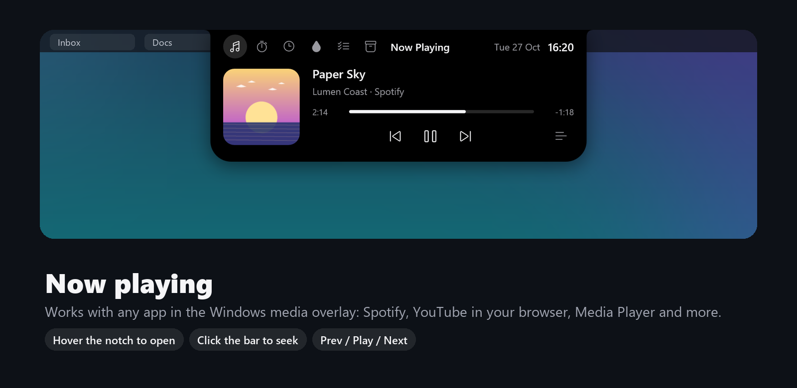

## Move it to any edge

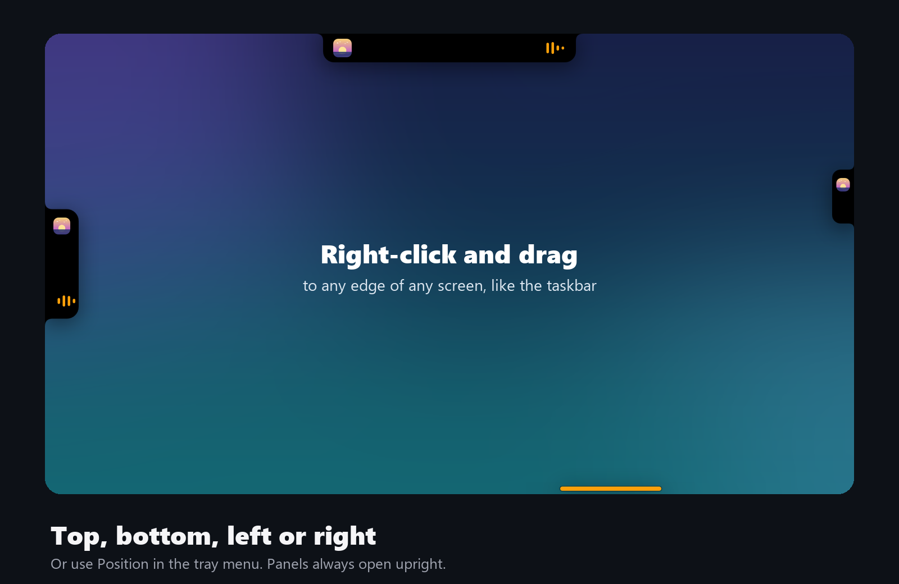

- **Right-click and drag** the notch. It snaps to the nearest edge of whichever screen the mouse is on: top, bottom, left or right. Let go to place it.
- Or right-click, open **Position** and pick an edge. **Center on edge** puts it back in the middle.
- On the left and right edges the closed notch becomes a vertical tab. Panels always open upright.
- A plain right-click (without dragging) opens the menu.

## Notch styles

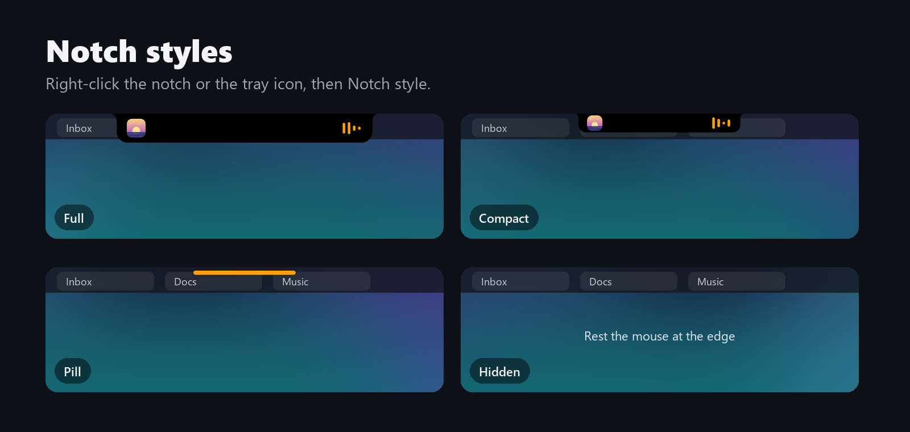

Right-click, then **Notch style**:

| Style | Looks like | Best for |
|---|---|---|
| Full | Black notch with the clock, music and timers | Seeing everything at a glance |
| Compact | A smaller notch | Less space, still glanceable |
| Pill | A thin bar, tinted while music or a timer runs | Almost invisible |
| Hidden | Nothing | Rest the mouse at the edge to open |

## Now playing and lyrics

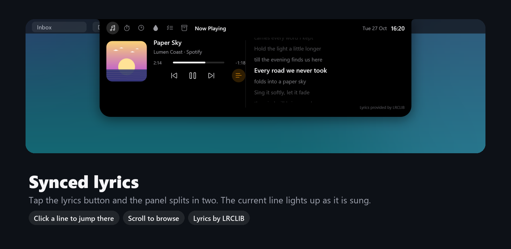

- Works with anything that shows in the Windows media overlay: Spotify, YouTube and other sites in Chrome, Edge or Firefox, Media Player and more.
- **Click the progress bar** to seek. Use the previous, play/pause and next buttons.
- **Lyrics**: click the lines button on the right. The panel splits and the current line lights up. Click a line to jump to it, or scroll to look ahead.
- When music plays, the closed notch shows the album art and a small equaliser.
- Some songs have no lyrics on LRCLIB yet; the panel then says *Lyrics not available*.

## Timer and stopwatch

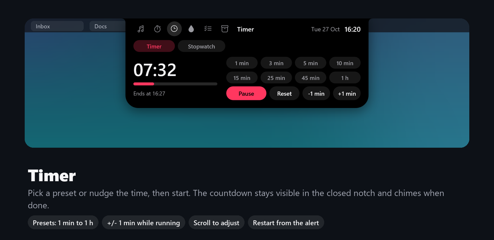

**Countdown**

1. Open the **Timer** tab (the clock icon).
2. Pick a preset (1 min to 1 h) or use **-1 min** / **+1 min**. While it is stopped you can also scroll over the panel to change it by a minute.
3. Press **Start**. The time left and *Ends at* show in the panel, and a countdown ring stays in the closed notch.
4. **+1 min / -1 min** also work while it is running, without restarting.
5. When it finishes it chimes and drops an alert with **Restart** and **Dismiss**.

WindyLand remembers your last duration.

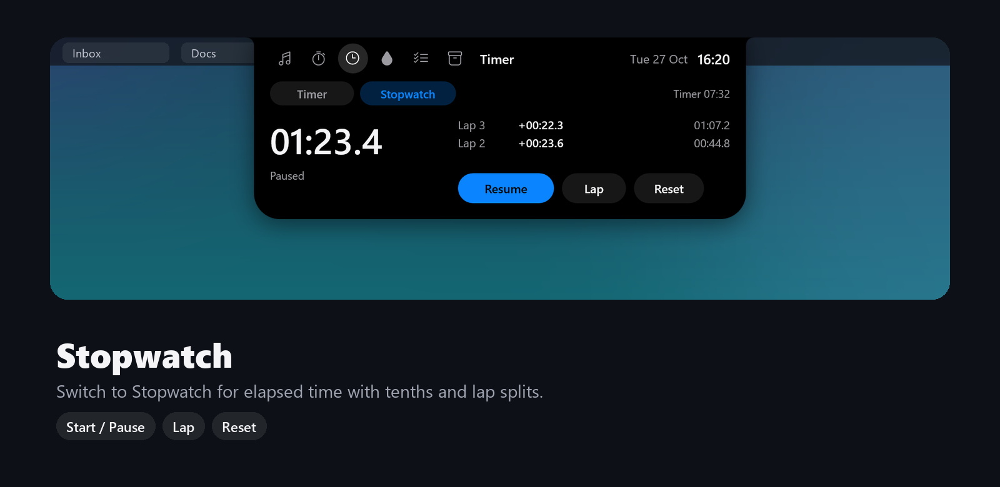

**Stopwatch**: switch to **Stopwatch**, then **Start**, **Lap** and **Reset**. Laps show the split and the total.

## Pomodoro

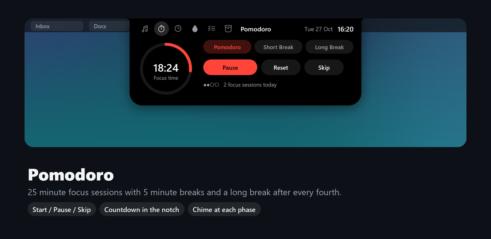

- 25 minutes of focus, then a 5 minute break. Every fourth break is 15 minutes.
- **Start / Pause**, **Reset** and **Skip** control the current phase.
- At the end of each phase it chimes and offers **Start** for the next one, or **Later**.
- The dots show your progress through the cycle of four.

## To-do with reminders

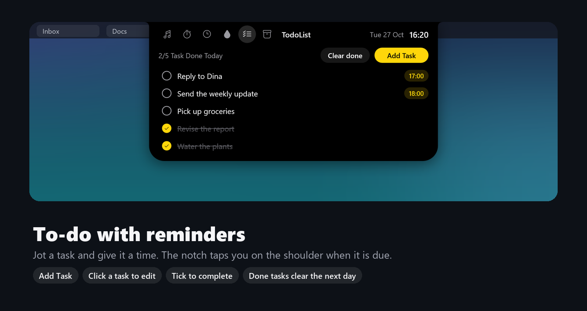

- **Add Task**, type a title, and optionally give it a time.
- Click a task to edit it. Click the circle to tick it off. Hover a task to delete it.
- When a task is due, the notch drops down with **Done** and **Snooze 10m**.
- Tasks you complete are cleared the next day. **Clear done** removes them now.

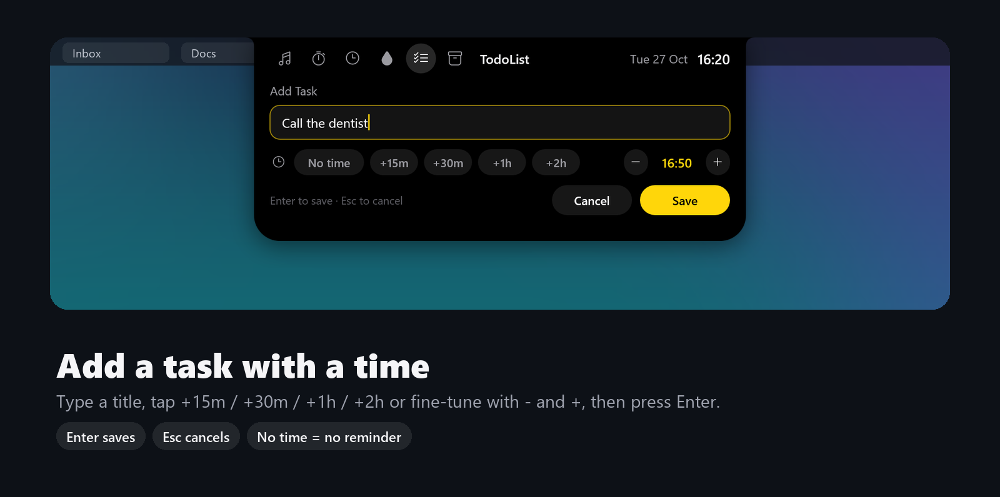

**Setting a time:** tap **+15m**, **+30m**, **+1h** or **+2h** (they add up), then fine-tune with **-** and **+**. **No time** means no reminder. Press **Enter** to save or **Esc** to cancel. You can paste with **Ctrl+V**.

## Water reminder

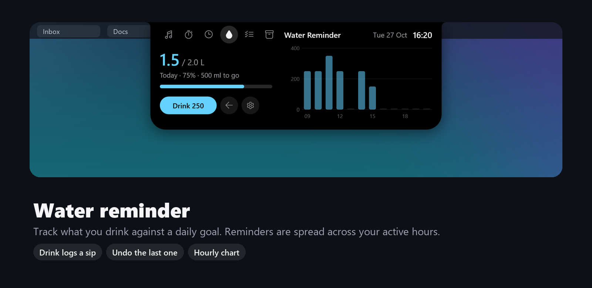

- **Drink** logs one sip. The arrow button undoes the last one.
- The chart shows what you drank each hour today.
- Reminders are spread evenly across your active hours until you reach your goal. Each one offers **Drank** or **Snooze**.
- When you have drunk a bottle's worth, it asks you to refill.

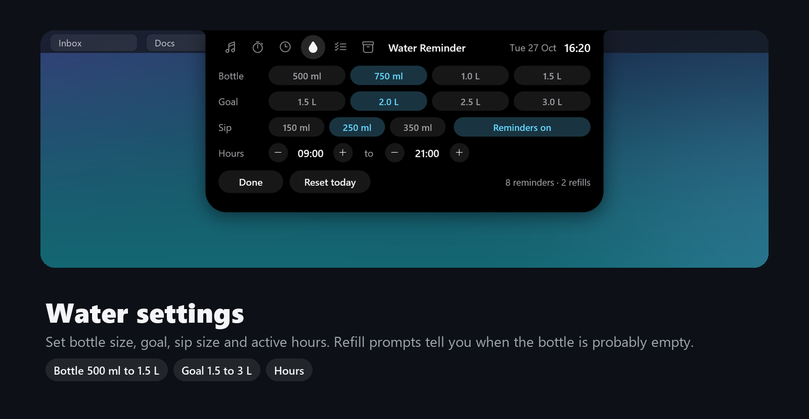

The gear button opens settings: bottle size, daily goal, sip size, active hours and reminders on or off. **Reset today** asks before clearing.

## File shelf

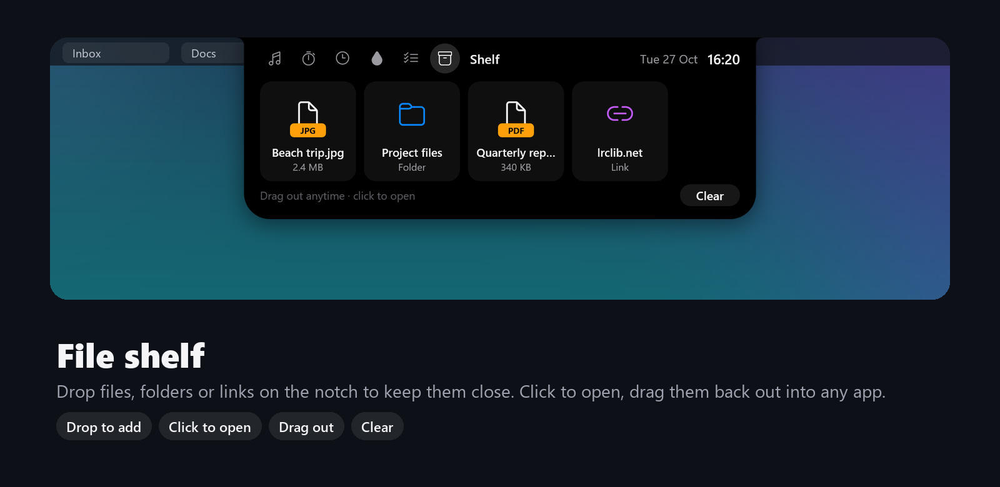

- **Drag files, folders or browser links onto the notch.** It opens the Shelf and shows *Release to add*.
- **Click** an item to open it. **Drag** it out into a chat, an email or a folder.
- Hover an item and click the **x** to remove it. **Clear** empties the shelf.
- The shelf keeps links to your files, not copies.

## Alerts and overlays

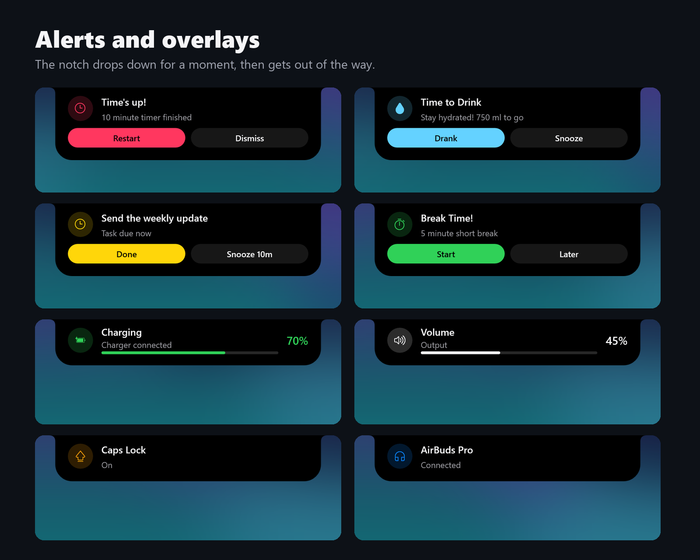

The notch briefly drops down for:

- charger connected or unplugged, low battery (20%), critical battery (10%) and fully charged
- internet connected, no internet access, or disconnected
- Caps Lock on or off, and keyboard language changes
- volume changes (turn off with **Volume overlay** in the menu)
- Bluetooth devices connecting or disconnecting

## The mascot

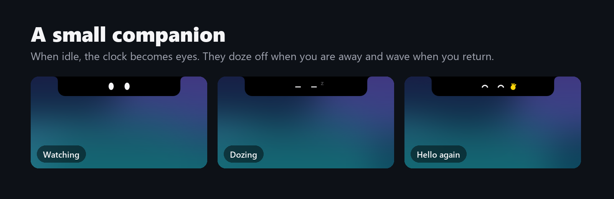

In the **Full** style, after a while with nothing going on, the clock turns into a pair of eyes that follow your mouse. After two minutes away they doze off, and they wave when you come back. Turn this off with **Personality** in the menu.

## Settings and your data

Right-click the notch or the tray icon:

| Item | What it does |
|---|---|
| Start with Windows | Launch at sign-in |
| Notch style | Full, Compact, Pill or Hidden |
| Position | Top, Bottom, Left, Right, Center on edge |
| Personality | Mascot eyes on or off |
| Volume overlay | Show volume changes |
| Open data folder | Opens `%APPDATA%\WindyLand` |
| About / Exit | |

Everything is stored as plain text in `%APPDATA%\WindyLand` (`settings.txt`, `todo.txt`, `water.txt`, `shelf.txt`). Uninstalling from **Settings > Apps** asks whether to delete it too.

## Troubleshooting

- **Nothing in Now playing.** Make sure the player shows up in the Windows media overlay (press a media key and look at the volume flyout).
- **The notch disappeared.** It hides while a full-screen game, video or presentation is running.
- **It opens when I reach for my tabs.** Switch to the Compact, Pill or Hidden style, or move it to another edge.
- **Lyrics not available.** The song is not on LRCLIB yet, or the title from the player is too unusual to match.
